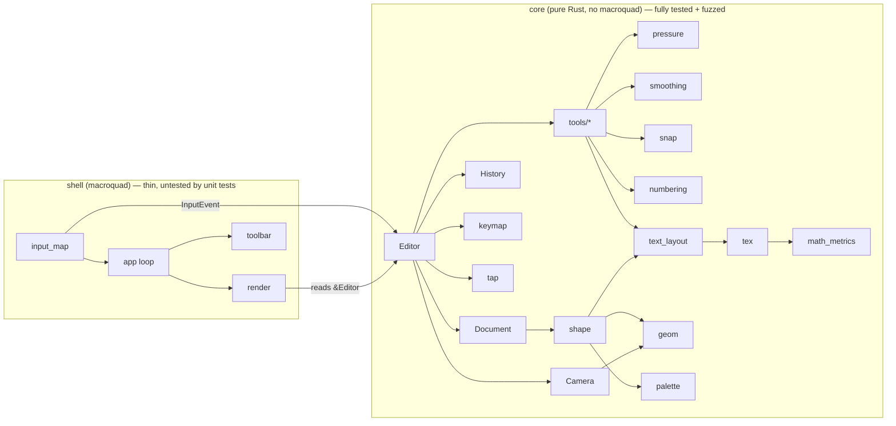

# Architecture

> This note describes the *current* architecture. Its history lives in the
> [[Decision Log]]; when an ADR changes something here, update this note in the
> same task and link the ADR.

## Shape of the program

- **core** knows nothing about windows, GPUs or macroquad. It consumes
  `InputEvent`s and exposes state. Everything here is unit-tested and fuzzed.
- **shell** translates macroquad input into `InputEvent`s, feeds the `Editor`,
  and draws its state. It contains no editing logic.

## Module map (owner task in parentheses)

| Module | Responsibility |
|--------|----------------|
| `core::geom` ([[T01 Geometry primitives]]) | `Vec2`, `Aabb`, distance to segment, finite-float helpers |
| `core::palette` ([[T02 Palette and theme tokens]]) | Fixed drawing colours + UI theme tokens |
| `core::camera` ([[T03 Camera]]) | World ↔ screen transform, pan, zoom-at-cursor, clamping |
| `core::smoothing` ([[T04 Stroke smoothing]]) | Anti-tremor: resample, EMA, Douglas–Peucker |
| `core::shape` ([[T05 Shape model]], grid + labels [[T16 Shape model v2 and helper skeleton]]) | `Shape` enum (incl. `Grid`, `Rect`/`Ellipse` labels), style, bounds, hit-test, inside-test, translate, `grid_lines` |
| `core::document`, `core::history` ([[T06 Document and history]]) | Ordered shape store with ids; transactional undo/redo |
| `core::input`, `core::command`, `core::editor`, `core::tools::{mod,navigate}` ([[T08 Editor core and input model]]) | Input model, command enum, editor state + dispatch, pan/zoom |
| `core::tools::{pen,shape_tool}` ([[T09 Creation tools]]) | Pen, rectangle, ellipse, line, arrow |
| `core::tools::{eraser,bucket,select}`, `core::clipboard` ([[T10 Editing tools]]) | Erase, fill, select/move, copy/paste/duplicate |
| `core::keymap` ([[T11 Keymap and macros]]) | Key chords → `Command` |
| `core::editor::Helpers` ([[T16 Shape model v2 and helper skeleton]]) | Snap flags, numbering counter, grid size; carried in `DrawStyle` ([[ADR-T16-3 Helper settings and hooks]]) |
| `core::snap` ([[T17 Snapping]]) | Snap dragged points: grid → size → align → round, alignment guides ([[ADR-T17-1 Snapping order and tolerances]]) |
| `core::tools::grid` ([[T18 Grid tool]]) | Grid tool: drag a box, `cols × rows` read live from `Helpers`, `Shift` = square cells ([[ADR-T18-1 Grid drag reads live dims and snaps as a box]]) |
| `core::numbering` ([[T19 Auto-numbering]]) | Labels for new rectangles/ellipses; counter rules for gesture end, undo and redo ([[ADR-T19-1 Numbering counter and undo]]) |
| `core::text_layout`, `core::tools::text` ([[T29 Text blocks]]) | Monospaced layout of `Shape::Text` (bounds, caret ↔ point, glyph cells — [[ADR-T29-1 Text shape with monospaced layout and an embedded font]]); the Text tool and the `TextEdit` session the editor routes `Char` events and editing keys to ([[ADR-T29-2 Text edit mode]]) |
| `core::tex` ([[T30 Basic TeX formulas]]) | `$…$` formulas in text blocks: lossless parse tree, reduced TeX box layout into glyphs (text or math face) and rules; `text_layout::typeset` caches it per text and `text_layout::bounds` uses its size, the edit session the source box ([[ADR-T30-1 TeX subset, box layout and metrics]]) |
| `core::experimental` ([[T31 Text in rectangles and grid cells]]) | `DRAW_EXPERIMENTAL` parsed into `Experimental` flags, carried in `Helpers::experimental`; `shape-text` turns on text in rectangles, ellipses and grid cells — `Shape::{Rect,Ellipse}::text`, `Shape::Grid::texts`, fitted by `text_layout::fit`, edited by a hosted `TextEdit` ([[ADR-T31-1 Shape text prototype behind a switch]]) |
| `core::math_metrics` ([[T33 Math font for formulas]]) | Per-glyph advance, ink box and italic correction of the embedded Latin Modern Math subset, generated by `scripts/math_metrics.py`; lets `core::tex` lay out formulas without a font ([[ADR-T33-1 Latin Modern Math for formulas with a metrics table in core]]) |
| `core::pressure` ([[T35 Pen pressure and native Wayland tablets]]) | Pen pressure → per-point width factor `clamp(2p, 0.25, 2)`, stored in `Shape::Stroke::widths` by the Pen tool; the smoother carries factors through resampling, EMA and RDP ([[ADR-T35-2 Pressure as per-point width factors on pen strokes]]) |
| `core::tap` ([[T34 Pen tablet input]]) | `TapFilter` at the top of `Editor::handle`: while a pen tablet is attached, a press released within 16 px is delivered as a click at the press point ([[ADR-T34-1 Tap slop for pen tablets detected at start-up]]) |
| `shell::render` ([[T07 Renderer]]) | Draw shapes (grids, labels, text blocks in the embedded fonts — [[ADR-T29-1 Text shape with monospaced layout and an embedded font]]) and previews through the camera, shapes and glyphs in one page-bound `Batch` ([[ADR-T32-2 Shapes and glyphs share one textured batch]]); snap dot grid (`draw_underlay`) and alignment guides (`draw_guides`) |
| `shell::glyphs` ([[T32 Fast text rendering]]) | Glyph atlas: fontdue rasterization once per `(face, char, px)` — text font or math font ([[ADR-T33-1 Latin Modern Math for formulas with a metrics table in core]]) — shelf-packed pages with a white block, partial texture uploads, glyph quads ([[ADR-T32-1 Own glyph atlas rasterized with fontdue]]) |
| `shell::{app,input_map,toolbar}` ([[T12 App shell and toolbar]]) | Window, event loop, toolbar UI |
| `shell::tablet` ([[T34 Pen tablet input]]) | `DRAW_TABLET` and `/proc/bus/input/devices` → pen mode and the editor's tap slop, read once at start-up ([[ADR-T34-1 Tap slop for pen tablets detected at start-up]]) |
| `vendor/miniquad` ([[T35 Pen pressure and native Wayland tablets]]) | miniquad 0.4.11 patched through `[patch.crates-io]`: `miniquad::pen` samples, pen pressure from X11 raw events, `zwp_tablet_v2` on Wayland; changes listed in `vendor/miniquad/PATCHED.md` ([[ADR-T35-1 Vendored miniquad with a pen tablet patch]]) |
| `tests/fuzz.rs` ([[T13 Fuzz harness]]) | Random input-sequence fuzzing of `Editor` |

## Data flow per frame

The loop sleeps in miniquad's blocking event loop and wakes only on input or
resize ([[ADR-T12-1 Blocking event loop with cached frame]]). Per woken frame:

1. `shell::input_map::Collector` yields every raw event since the last frame,
   in order, as `InputEvent`s in logical screen pixels — typed characters
   as `InputEvent::Char`, just before their key. It first takes the frame's
   `miniquad::pen` samples and pairs them with pointer events by position,
   emitting `InputEvent::Pressure` whenever the pen pressure changes
   ([[ADR-T35-1 Vendored miniquad with a pen tablet patch]]).
2. `shell::toolbar::route` sends presses on the visible toolbar to
   `Editor::apply(command)`; everything else goes to `Editor::handle(event)`.
   Both return whether anything changed. `Editor::handle` first passes the
   event through `core::tap::TapFilter`, which holds pen taps still
   ([[ADR-T34-1 Tap slop for pen tablets detected at start-up]]). While a text block is open,
   `Editor::handle` sends characters and editing keys to it instead of
   the keymap, and `Editor::apply` commits it first
   ([[ADR-T29-2 Text edit mode]]).
3. The shell builds the document layer's key — `Editor::document_revision`,
   shape count, camera, framebuffer size, `overlay.hidden`, grid snap — and
   `shell::app::plan_redraw` compares it with the cached one
   ([[ADR-T24-1 Document layer keyed by a document revision]]):
   - only shapes added on top since the cached layer
     (`Editor::document_base_revision` ≤ cached revision, view unchanged)
     → draw just those onto the **document layer**
     ([[ADR-T24-3 Batched meshes and append-only document updates]]);
   - only the camera changed and the last full re-render took ≥ 8 ms → keep
     the layer and blit it moved and scaled (`Redraw::Moved`,
     [[ADR-T26-3 Reuse the layer only when re-rendering is slow]]); a
     cheaper scene re-renders as below; once the camera has been still for `SETTLE`
     (100 ms) re-render it, waking the loop with `schedule_update` from the
     main thread until then
     ([[ADR-T26-1 Reuse the document layer during pan and zoom]]);
   - any other key change → re-render the document layer (background,
     underlay dot grid, shapes minus `overlay.hidden`);
   - otherwise → keep it.
   The document layer is a cached, 4× multisampled render target
   ([[ADR-0006 Redraw on demand]], [[ADR-T15-1 MSAA on the cached frame]])
   covering the window plus a margin of ⅛ of its longer side, rendered
   through a camera shifted by that margin.
   `shell::render` tessellates shapes into a `Batch` submitted with
   `draw_mesh` in chunks; strokes are one mitred strip each
   ([[ADR-T24-4 Strokes as one strip with sparse round joins]]). Text
   blocks, labels and grid indices are glyph quads from the
   `shell::glyphs` atlas in the same chunks — formulas typeset, each
   glyph at its own scale, with fraction bars and root signs as quads
   ([[ADR-T30-1 TeX subset, box layout and metrics]]) — which are bound to one atlas
   page each ([[ADR-T32-1 Own glyph atlas rasterized with fontdue]],
   [[ADR-T32-2 Shapes and glyphs share one textured batch]]); an atlas
   that overflowed is cleared at the start of the next frame and the layer
   re-rendered once.
   `DRAW_FRAME_TIMES=1` logs each re-render, with the frame's text time
   and rasterized glyphs. More
   ideas: [[Rendering performance options]].
4. The document layer is blitted to the window (one quad, 1:1 at rest) and
   the overlay —
   overlay shapes (including the open text block, drawn as typed with
   formulas as source, whose original is in `overlay.hidden`), its caret, guides, selection, marquee, toolbar — is
   drawn on top,
   single-sampled ([[ADR-T24-2 Overlay drawn straight to the window]]).

## Invariants (checked by the fuzzer)

- No panic for any input sequence, including NaN/∞/huge coordinates.
- All stored coordinates are finite.
- Undo all → empty document; redo all → identical document.
- Camera zoom stays within `[ZOOM_MIN, ZOOM_MAX]`.
- Selection only refers to shape ids that exist.
- Grid dimensions (of shapes and of the editor's settings) are in
  `1..=GRID_MAX_CELLS`; labels and the numbering counter are ≥ 1.
- Text blocks have a positive size and non-blank text; their box is finite
  and holds their typeset ink.
- Shape and cell texts exist only with `shape-text` on; they are non-blank
  with a finite positive size, and cell texts lie inside their grid,
  sorted by `(row, col)`, unique.
