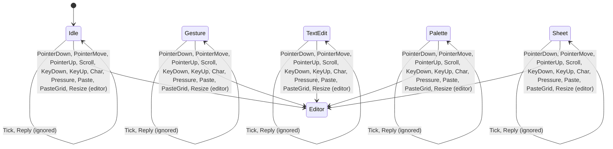

# Control automaton

The editor's control flow as a pure transition function (see
[[2.0 Architecture proposal]] §3 and
[[ADR-T134-1 The automaton wraps the editor behind a routing table]]):

```text
step : (Machine, Input) -> (Machine, Vec<Effect>)
```

Code: `crates/draw-core/src/machine/`.

- **`Input`** — pointer down, move and up, scroll, key down and up, char,
  pressure, paste, paste-grid, resize, `Tick(Instant)` and `Reply(..)`.
- **`Interaction`** (the state) — `Idle`, `Gesture(ActiveGesture)`,
  `TextEdit`, `Palette`, `Sheet`. The two overlays win over the others,
  because they capture every input.
- **`Effect`** — `Redraw`, `Clipboard`, `Save`, `ExportPng`, `ExportSvg`,
  `CopyImage`, `Notify`, `Schedule`. They replace the polling flags the
  shell used to collect one by one.
- **Regions** (T135, [[ADR-T135-1 Regions live in the machine module]]) —
  `Modal` (`Closed | Palette | Sheet`, one overlay at a time), `Pages` and
  `View` (camera and selection) are defined in `machine/regions.rs`; the
  editor holds one of each in place of the six loose fields.
- **Routing table** — `route(InteractionKind, InputKind)`, a `match` with no
  wildcard arm: a new state or input does not compile until every cell is
  decided, "ignored" included. Today the editor still does the work behind
  the `editor` cells (the old `Editor` is an adapter); T135 to T137 move
  behaviour into the table.

## Diagram

The diagram is generated by `machine::diagram()` from the table. The test
`diagram_matches_the_table` fails when this block and the table differ; to
regenerate it, print `diagram()` and paste it between the markers.

<!-- diagram:begin -->

<!-- diagram:end -->
